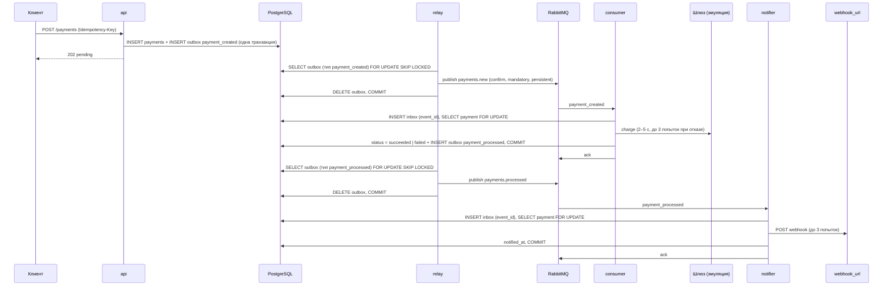

# Payment Service

Микросервис асинхронной обработки платежей: API принимает платёж и отвечает `202` сразу,
обработка идёт в фоне через RabbitMQ (transactional outbox → очередь `payments.new` → эмуляция
платёжного шлюза → событие «платёж проведён» через outbox → очередь `payments.processed` →
webhook клиенту), сообщения, которые нельзя обработать, уходят в DLQ своей очереди.

Стек: Python 3.12, FastAPI + Pydantic v2, SQLAlchemy 2.0 async (asyncpg), PostgreSQL 17,
Alembic, RabbitMQ 4 (FastStream + aio-pika), httpx, uv, Docker Compose.
Архитектура — гексагональная (Ports & Adapters): ядро не знает о FastAPI, SQLAlchemy и RabbitMQ.

## Быстрый старт

```bash
cp .env.example .env            # порты, учётные данные, API-ключ (AUTH_API_KEY)
docker compose up -d --build --wait
```

Поднимаются `db`, `rabbitmq` (management UI — http://localhost:15672, guest/guest), `api`
(применяет миграции и слушает http://localhost:8000; Swagger — `/docs`), `relay` (outbox →
RabbitMQ), `consumer` (проведение платежей через шлюз), `notifier` (доставка webhook),
`webhook_sink` (эхо-приёмник webhook: пишет каждый запрос в свой лог).

```bash
# создать платёж (все эндпоинты требуют X-API-Key из .env)
curl -s -X POST http://localhost:8000/api/v1/payments \
  -H "X-API-Key: dev-api-key-change-me-0123456789" \
  -H "Idempotency-Key: order-42-attempt-1" \
  -H "Content-Type: application/json" \
  -d '{"amount": "100.50", "currency": "RUB", "description": "Заказ №42",
       "metadata": {"order_id": 42}, "webhook_url": "http://webhook_sink:8080/payments"}'
# → 202 {"payment_id": "…", "status": "pending", "created_at": "…"}

# статус (через 2–5 с станет succeeded или failed)
curl -s http://localhost:8000/api/v1/payments/<payment_id> \
  -H "X-API-Key: dev-api-key-change-me-0123456789"

# webhook, который получил приёмник
docker compose logs webhook_sink | grep <payment_id>
```

`webhook_url` указывает адрес **внутри сети compose** (`http://webhook_sink:8080/...`): `localhost`
внутри контейнера `notifier` — это сам notifier. Повтор `POST` с тем же `Idempotency-Key` и тем
же телом возвращает исходный платёж (`202`); с тем же ключом и другим телом — `409`.

Остановить стенд: `docker compose down` (с данными — `docker compose down -v`).

## Как это работает



Одно сообщение — один сценарий в одной транзакции: проведение платежа и уведомление клиента —
разные события, разные очереди и разные процессы. Медленный получатель webhook не задерживает
проведение платежей, а сбой доставки не заставляет повторять обращение к шлюзу.

1. **Создание.** `POST /api/v1/payments` в одной транзакции пишет платёж и событие
   `payment_created` в таблицу `outbox`. Ключ идемпотентности — уникальный индекс: гонка двух
   одинаковых запросов даёт одну строку и одно событие (`INSERT … ON CONFLICT DO NOTHING`).
2. **Outbox → RabbitMQ.** Процесс `relay` забирает события пачками (`FOR UPDATE SKIP LOCKED`),
   у каждого типа события — своя пачка и своя транзакция («дорожка»): `payment_created` уходит с
   ключом `payments.new`, `payment_processed` — с ключом `payments.processed`, в обменник
   `payments` с подтверждением брокера (publisher confirms, `mandatory`, `persistent`); затем
   события удаляются. Сбой публикации — событие остаётся и уйдёт на следующей итерации:
   доставка **не менее одного раза**, `message_id` = `event_id` события. Недоступная очередь
   одного типа не задерживает остальные.
3. **Проведение.** `consumer` читает `payments.new` (prefetch 1, ручной `ack`). Первой операцией
   транзакции событие регистрируется в таблице `inbox` (Idempotent Receiver), затем платёж
   блокируется `FOR UPDATE` и вызывается шлюз — эмуляция: задержка 2–5 с, отказ с вероятностью
   10 %. Отказ повторяется трижды с экспоненциальной паузой (1 с, 2 с) **в том же потоке**: это
   настоящие ошибки внешней стороны, а не повод гонять сообщение по очередям. После третьего
   отказа платёж становится `failed`, после успеха — `succeeded`; фиксируется `processed_at`, и в
   той же транзакции в outbox кладётся событие `payment_processed`.
4. **Уведомление.** `notifier` читает `payments.processed`, так же регистрирует событие в inbox,
   блокирует платёж и отправляет на `webhook_url` `POST` с результатом (тело — ниже), до трёх
   попыток при недоступности получателя (сбой сети, таймаут, 5xx, 408, 429, 3xx). Ответ 2xx —
   доставлено, фиксируется `notified_at`. Ответ 4xx (кроме 408/429) — получатель отверг, повтор
   бессмыслен.
5. **Подтверждение.** Сообщение подтверждается после фиксации транзакции сценария — или после
   записи в DLQ.

Повторная доставка сообщения (например, процесс упал до `ack`) безопасна: регистрация в inbox
по `event_id` идёт первой операцией транзакции, повтор зафиксированного события ничего не делает,
а копия того же события в параллельной транзакции ждёт исхода первой и получает «уже
обработано». Если сценарий не зафиксирован (сбой, отказ), откатывается и регистрация — повтор
обработает событие заново. Сверх inbox сущность проверяет переход: проведённый платёж через шлюз
не идёт, уведомлённому клиенту webhook повторно не уходит.

### Политика ошибок консьюмеров

Одна таблица у `consumer` и `notifier` (`adapters/new_payments/policy.py`,
`adapters/processed_payments/policy.py`):

| Исход попытки | Действие | Примеры |
|---|---|---|
| Сообщение не по контракту | **DLQ**, `ack` | не JSON, не тот `type`, нет `payment_id` |
| Ошибка данных или правил | **DLQ**, `ack` | платежа нет в БД, недопустимый переход, событие с тем же `event_id` и другим содержимым, получатель webhook ответил 4xx |
| Внешняя сторона недоступна после повторов | **DLQ**, `ack` | получатель webhook не отвечает после 3 попыток |
| Собственная инфраструктура недоступна | **повтор на месте** с паузой 0.5 → 10 с в пределах бюджета 120 с; по исчерпании — остановка без `ack` | БД недоступна, дедлок, `lock_timeout`, дедлайн попытки |
| Дефект кода или конфигурации | **остановка** процесса без `ack` | неожиданное исключение, нет прав в БД |

Платёж, ставший `failed` после трёх отказов шлюза, — **проведённый** платёж: сообщение
подтверждается, в DLQ не попадает, клиент получает webhook со статусом `failed`. В DLQ уходит
то, что сервис не смог обработать по вине данных или внешней стороны. Сообщение, из-за которого
процесс остановился, вернётся в очередь и будет обработано первым после исправления:
crash-loop на дефекте — осознанный выбор, он виден в `docker compose ps` сразу, а не через
неделю по растущей DLQ.

При лежащей БД очередь **не сливается в DLQ**: такие сбои повторяются на месте.

### Топология RabbitMQ

| Объект | Имя | Назначение |
|---|---|---|
| exchange (direct, durable) | `payments` | события платежей; ключ маршрутизации — по типу события |
| queue (durable) | `payments.new` | `payment_created`; `x-dead-letter-exchange: payments.dlx` |
| queue (durable) | `payments.processed` | `payment_processed`; `x-dead-letter-exchange: payments.dlx` |
| exchange (direct, durable) | `payments.dlx` | недоставленные сообщения обеих очередей |
| queue (durable) | `payments.new.dlq` | DLQ consumer; сообщения кладёт консьюмер явно с заголовками причины |
| queue (durable) | `payments.processed.dlq` | DLQ notifier |

Рабочую очередь (с аргументами `x-dead-letter-*`) и её DLQ объявляет её консьюмер при старте
(`rabbitmq.declare`); подписчик получает описания без объявления. Обменники `payments` и
`payments.dlx` объявляются одинаково всеми, кому нужны (direct, durable, идемпотентно): relay не
зависит от того, стартовали ли консьюмеры. Пока очередь не объявлена, публикация с `mandatory`
возвращается — событие ждёт в outbox. В DLQ уходят **исходные** байты тела, `message_id`,
`content_type` и заголовки сообщения (`x-event-type`) плюс причина: `x-error-code`
(`payment_not_found`, `payment_transition_not_allowed`, `message_conflict`,
`webhook_unavailable`, `webhook_rejected`, `InvalidMessage`, …), `x-error` (текст),
`x-attempts`, `x-original-exchange`, `x-original-routing-key`, `x-failed-at`. После
исправления сообщение можно опубликовать обратно в `payments` с исходным ключом как есть
(например, shovel в management UI).

Если рабочая очередь уже существует с другими аргументами, RabbitMQ ответит
`PRECONDITION_FAILED` — консьюмер остановится с этой ошибкой; удалите очередь или приведите
`NEW_PAYMENTS_*` / `PROCESSED_PAYMENTS_*` в соответствие.

### Тело webhook

```json
{
  "payment_id": "7c9e6679-7425-40de-944b-e07fc1f90ae7",
  "status": "succeeded",
  "amount": "100.50",
  "currency": "RUB",
  "description": "Заказ №42",
  "metadata": {"order_id": 42},
  "created_at": "2026-11-10T12:00:00Z",
  "processed_at": "2026-11-10T12:00:04Z"
}
```

Заголовки: `Content-Type: application/json`, `X-Payment-Id: <payment_id>`. Доставка — **не менее
одного раза** (ответ 2xx мог потеряться до фиксации `notified_at`): получатель должен
дедуплицировать по `X-Payment-Id` и на повтор отвечать 2xx. Редиректы не выполняются, cookies не
сохраняются, прокси из окружения не используются.

### Известные ограничения

- `webhook_url` не фильтруется по адресатам — клиент с API-ключом может направить уведомление на
  внутренний адрес сети (SSRF); в production нужен allow-list или запрет приватных диапазонов.
- Порт шлюза требует идемпотентности по `payment.id`: повтор сообщения после сбоя `COMMIT`
  вызывает шлюз снова. Эмуляция помнит принятые платежи в памяти процесса; настоящий шлюз
  потребует ключ идемпотентности (`payment_id`), иначе оплата прошла бы дважды.
- Таблица `inbox` не очищается: строка на каждое обработанное событие. В production — удаление
  записей старше окна повторной доставки (дни) фоновой задачей.
- Обновление стенда с прежней версии (один консьюмер на оба шага): сначала
  `docker compose stop relay consumer`, затем `docker compose up -d --build --wait`. Миграция
  `0002` добавляет события `payment_processed` для проведённых, но не уведомлённых платежей —
  их уведомит `notifier`; прежний relay такие события не прочитал бы. Сообщения прежней версии в
  `payments.new.dlq` с причинами `webhook_*` обратно не публиковать: уведомление по ним уже в
  outbox, а повтор проведения отклонится как недопустимый переход. По той же причине не
  возвращать записи `payments.new.dlq` с причиной `payment_transition_not_allowed`, появившиеся
  при выкладке: прежний consumer, остановленный между проведением и уведомлением, оставляет
  сообщение в очереди, а уведомление по нему создаёт миграция. Если `consumer` перед выкладкой
  не остановили, платёж, проведённый им после миграции с отказом webhook, останется без
  уведомления — после выкладки повторите вставку событий из миграции `0002` для платежей
  `status <> 'pending' AND notified_at IS NULL`, у которых ещё нет `payment_processed` в outbox.
  Откат миграции (`downgrade 0001`) возвращает неуведомлённым платежам `payment_created` для
  прежнего consumer. Переменная
  `PAYMENT_EVENTS_ROUTING_KEY` переименована в `PAYMENT_EVENTS_CREATED_ROUTING_KEY`, добавлены
  `PAYMENT_EVENTS_PROCESSED_ROUTING_KEY` и `PROCESSED_PAYMENTS_*`.

## API

Все эндпоинты требуют заголовок `X-API-Key` (значение — `AUTH_API_KEY` из `.env`); без него или
с неверным ключом — `401` с `WWW-Authenticate: ApiKey header="X-API-Key"`. OpenAPI — `/docs`,
`/openapi.json`.

| Метод | Путь | Ответ |
|---|---|---|
| `POST` | `/api/v1/payments` | `202` `{payment_id, status, created_at}`; `400` нет/пустой `Idempotency-Key` или невалидное тело; `409` ключ уже использован с другим телом |
| `GET` | `/api/v1/payments/{payment_id}` | `200` платёж; `404` |
| `GET` | `/api/v1/healthcheck` | `200` (без ключа; для healthcheck compose) |

Тело `POST`: `amount` (строка или число > 0, не более двух знаков), `currency` (`RUB`/`USD`/`EUR`),
`description` (до 1000 символов, по умолчанию пусто), `metadata` (JSON-объект до 4 КБ),
`webhook_url` (`http`/`https`, без учётных данных). Заголовок `Idempotency-Key` — непустой, до 255
символов.

Ответ `GET`:

```json
{
  "payment_id": "7c9e6679-7425-40de-944b-e07fc1f90ae7",
  "idempotency_key": "order-42-attempt-1",
  "amount": "100.50",
  "currency": "RUB",
  "description": "Заказ №42",
  "metadata": {"order_id": 42},
  "webhook_url": "http://webhook_sink:8080/payments",
  "status": "succeeded",
  "created_at": "2026-11-10T12:00:00Z",
  "processed_at": "2026-11-10T12:00:04Z",
  "notified_at": "2026-11-10T12:00:04.5Z"
}
```

Сверх ТЗ: поле `notified_at` (момент доставки webhook; `null`, пока не доставлен) — по нему видно,
дошло ли уведомление, без чтения логов.

Ошибки — единая форма `{"error": "<текст>", "code": "<snake_case>", "context": {...}}`:
`validation_error` (400, `context.details` — перечень нарушений), `credentials_missing` /
`credentials_invalid` (401), `payment_not_found` (404), `idempotency_key_conflict` (409),
`storage_unavailable` (503 + `Retry-After: 1`), `internal_error` (500).

## Настройки

Все параметры — переменные окружения или `.env` (см. `.env.example`, там же комментарии):
`POSTGRES_*`, `RABBITMQ_*`, `AUTH_API_KEY`, `LOG_LEVEL`, эмуляция шлюза `PAYMENT_GATEWAY_*`
(`PAYMENT_GATEWAY_FAILURE_RATE=1` — все платежи `failed`, `0` — все `succeeded`), webhook
`WEBHOOK_*`, relay `PAYMENT_EVENTS_*` (ключи маршрутизации по типу события),
`OUTBOX_POLLER_IDLE_INTERVAL`, `RELAY_BATCH_SIZE` (на тип события за итерацию), consumer
`NEW_PAYMENTS_*`, notifier `PROCESSED_PAYMENTS_*`.

Дедлайны связаны. Транзакция сценария держит регистрацию события в inbox, пока идёт обращение к
шлюзу (consumer) или доставка webhook (notifier), — копия события в другом экземпляре ждёт её.
Поэтому `lock_timeout` (`POSTGRES_LOCK_TIMEOUT_MS`, в compose 20 с у обоих) не меньше худшего
времени внешнего вызова (шлюз и webhook — по 3 × 5 с + паузы = 18 с), а дедлайн попытки —
не меньше `lock_timeout` + это время: `NEW_PAYMENTS_HANDLER_TIMEOUT` (60 с) ≥ 20 + 18,
`PROCESSED_PAYMENTS_HANDLER_TIMEOUT` (60 с) ≥ 20 + 18. Связки проверяются при старте процесса;
`stop_grace_period` контейнеров (80 с) даёт дорабатывающему сообщению завершиться и
подтвердиться при `docker compose stop`.

## Разработка и тесты

```bash
uv sync                              # зависимости + проект (editable)
uv run ruff check . && uv run ruff format --check . && uv run mypy . && uv run lint-imports
uv run pytest tests/payment_service/unit                      # без инфраструктуры
uv run pytest tests/payment_service/integration/adapters/api  # HTTP на моках портов, без БД
uv run pytest tests/payment_service/integration/adapters/rabbitmq  # публикатор → брокер → консьюмеры
uv run pytest                                                 # + интеграция с PostgreSQL и RabbitMQ
```

Интеграционные тесты БД ходят в `TEST_POSTGRES_*` (контейнер `db_for_tests` профиля `tests`),
тесты RabbitMQ — в `TEST_RABBITMQ_URL` (брокер стенда, временные очереди); без переменных
пропускаются. Поднять только инфраструктуру для тестов с хоста:

```bash
docker compose --profile tests up -d db_for_tests rabbitmq
```

В контейнере (отдельная БД, unit-тесты выполняются при сборке образа):

```bash
docker compose --profile tests run --rm --build tests
```

Миграции: `uv run python -m payment_service.launchers.alembic_runner upgrade head`
(`alembic.ini` нет — конфиг собирается из настроек); новая —
`... revision --autogenerate -m "<slug>" --rev-id 0003`.

## Структура

```
payment_service/
  application/            ядро: сущности, DTO, ошибки, порты (interfaces), сценарии (services)
    entities.py           Payment: State-машина pending → succeeded | failed, уведомление один раз
    services/             Payment (create/get/process/notify), EventRelay (дорожки outbox → publisher)
  adapters/
    api/                  FastAPI: контроллер v1, схемы запросов, DTO ответов, обработчики ошибок
    auth/                 статический API-ключ (сравнение за постоянное время)
    database/             SQLAlchemy: таблицы, imperative mapping, репозитории (payments, outbox,
                          inbox), Unit of Work, Alembic
    payment_events/       исходящий: публикация событий в RabbitMQ (ключ по типу, confirms, mandatory)
    outbox_poller/        входящий: цикл процесса relay
    new_payments/         входящий: payments.new → process — messages, handler, policy, settings
    processed_payments/   входящий: payments.processed → notify — то же
    payment_gateway/      исходящий: эмуляция шлюза + Decorator повторов
    webhook/              исходящий: httpx-доставка + Decorator повторов
    rabbitmq/             библиотека: брокер, топология, цикл консьюмера (повторы, ack), DLQ
    retry/, log/          библиотеки адаптеров: политика повторов, логи
  launchers/              composition roots: api, relay, consumer, notifier; process (сигналы, heartbeat)
tests/payment_service/    unit/ (без инфраструктуры), integration/ (api, database, rabbitmq)
deployment/entrypoints/   скрипты запуска контейнеров
```

Зависимости направлены внутрь (`launchers → adapters → application`) и проверяются
`import-linter`; адаптеры не знают друг о друге — их связывает composition root. Порт, который
процесс действительно вызывает (шлюз у consumer, webhook у notifier), сервис получает уже
обёрнутым декоратором повторов: ядро о повторах не знает. Транзакции — Unit of Work: `async with uow_factory() as uow: …;
await uow.commit()`; откат по выходу без `commit`; обрывы соединения, дедлоки и `lock_timeout`
переводятся в `StorageUnavailable`.

Словарь: *outbox* — таблица событий, записываемых в транзакции с платежом; *inbox* — таблица
обработанных входящих событий (`event_id` + отпечаток содержимого); *relay* — процесс доставки
outbox в брокер; *дорожка* — пачка событий одного типа в своей транзакции relay; *DLQ* —
очередь сообщений, которые не удалось обработать; *попытка* — один прогон сценария (`process`
или `notify`) над сообщением; *бюджет повторов* — сколько сообщение может повторяться из-за
сбоев инфраструктуры до остановки процесса.
